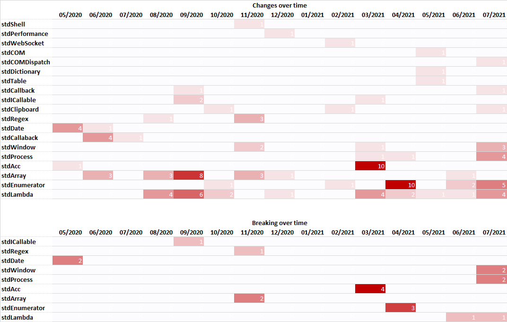

# stdVBA

A Collection of libraries to form a common standard layer for modern VBA applications.

[AI:0/W/X](https://0rwx.com/)

## [AI Attribution](https://0rwx.com/)

* AI:0 - Most modules have been hand crafted by humans.
* AI:W - Some modules have been reviewed by humans
* AI:X - Most new modules are generated, and the code isn't reviewed.

Generally speaking, `AI:0` and `AI:W` modules are transitioning to `AI:X`.

## Benefits

* Code faster!
* Improve code maintainability.
* Let the library handle the complicated stuff, you focus on the process 
* Heavily inspired by JavaScript APIs - More standard
* Open Source - Means the libraries are continually maintained by the community. Want something added, help us make it!

[The full roadmap](https://github.com/sancarn/stdVBA/projects/1) has more detailed information than here.

## Getting started

[A video series](https://www.youtube.com/watch?v=IJ8PNiqnuMU&list=PLfpJqtusLMmotZqzFtZ6FCPRin5N_BjPA) is being created to demonstrate how to get started with stdVBA. Alternatively there is a small getting started document [in the discussions](https://github.com/sancarn/stdVBA/discussions/30)

Browse the [generated API documentation](https://sancarn.github.io/stdVBA-docs/) for class and module references, examples, and dependencies. Documentation is generated from the source comments.

## Short example

Please visit [the examples repository](https://github.com/sancarn/stdVBA-examples) for more fully featured applications/examples using this library.
```vb
sub Main()
  'Create an array
  Dim arr as stdArray
  set arr = stdArray.Create(1,2,3,4,5,6,7,8,9,10) 'Can also call CreateFromArray

  'Demonstrating join, join will be used in most of the below functions
  Debug.Print arr.join()                                                 '1,2,3,4,5,6,7,8,9,10
  Debug.Print arr.join("|")                                              '1|2|3|4|5|6|7|8|9|10

  'Basic operations
  arr.push 3
  Debug.Print arr.join()                                                 '1,2,3,4,5,6,7,8,9,10,3
  Debug.Print arr.pop()                                                  '3
  Debug.Print arr.join()                                                 '1,2,3,4,5,6,7,8,9,10
  Debug.Print arr.concat(stdArray.Create(11,12,13)).join                 '1,2,3,4,5,6,7,8,9,10,11,12,13
  Debug.Print arr.join()                                                 '1,2,3,4,5,6,7,8,9,10 'concat doesn't mutate object
  Debug.Print arr.includes(3)                                            'True
  Debug.Print arr.includes(34)                                           'False

  'More advanced behaviour when including callbacks! And VBA Lamdas!!
  Debug.Print arr.Map(stdLambda.Create("$1+1")).join          '2,3,4,5,6,7,8,9,10,11
  Debug.Print arr.Reduce(stdLambda.Create("$1+$2"))           '55 ' I.E. Calculate the sum
  Debug.Print arr.Reduce(stdLambda.Create("application.worksheetFunction.Max($1,$2)"))      '10 ' I.E. Calculate the maximum
  Debug.Print arr.Filter(stdLambda.Create("$1>=5")).join      '5,6,7,8,9,10
  
  'Execute property accessors with Lambda syntax
  Debug.Print arr.Map(stdLambda.Create("ThisWorkbook.Sheets($1)")) _ 
                 .Map(stdLambda.Create("$1.Name")).join(",")            'Sheet1,Sheet2,Sheet3,...,Sheet10
  
  'Execute methods with lambdas and enumerate over enumeratable collections:
  Call stdEnumerator.CreateFromIEnumVariant(Application.Workbooks).forEach(stdLambda.Create("$1.Save"))
  
  'We even have if statement!
  With stdLambda.Create("if $1 then ""lisa"" else ""bart""")
    Debug.Print .Run(true)                                              'lisa
    Debug.Print .Run(false)                                             'bart
  End With
  
  'Execute custom functions
  Debug.Print arr.Map(stdCallback.CreateFromModule("ModuleMain","CalcArea")).join  '3.14159,12.56636,28.274309999999996,50.26544,78.53975,113.09723999999999,153.93791,201.06176,254.46879,314.159

  'Let's move onto regex:
  Dim oRegex as stdRegex
  set oRegex = stdRegex.Create("(?<county>[A-Z])-(?<city>\d+)-(?<street>\d+)","i")

  Dim oRegResult as object
  set oRegResult = oRegex.Match("D-040-1425")
  Debug.Print oRegResult("county") 'D
  Debug.Print oRegResult("city")   '040
  
  'And getting all the matches....
  Dim sHaystack as string: sHaystack = "D-040-1425;D-029-0055;A-100-1351"
  Debug.Print stdEnumerator.CreateFromIEnumVARIANT(oRegex.MatchAll(sHaystack)).map(stdLambda.Create("$1.item(""county"")")).join 'D,D,A
  
  'Dump regex matches to range:
  '   D,040,040-1425
  '   D,029,029-0055
  '   A,100,100-1351
  Range("A3:C5").value = oRegex.ListArr(sHaystack, Array("$county","$city","$city-$street"))
  
  'Copy some data to the clipboard:
  Range("A1").value = "Hello there"
  Range("A1").copy
  Debug.Print stdClipboard.Text 'Hello there
  stdClipboard.Text = "Hello world"
  Debug.Print stdClipboard.Text 'Hello world

  'Copy files to the clipboard.
  Dim files as collection
  set files = new collection
  files.add "C:\File1.txt"
  files.add "C:\File2.txt"
  set stdClipboard.files = files

  'Save a chart as a file
  Call stdImage.CreateFromChart(Sheets("Sheet1").ChartObjects(1).Chart).ToFile("C:\test.bmp", stdImgFormatBMP)
End Sub

Public Function CalcArea(ByVal radius as Double) as Double
  CalcArea = 3.14159*radius*radius
End Function
```

## Motivation

VBA first appeared in 1993 (over 25 years ago) and the language's age is definitely noticable. VBA has a lot of specific libraries for controlling Word, Excel, Powerpoint etc. However the language massively lacks in generic modern libraries for accomplishing common programming tasks. VBA projects ultimately become a mish mash of many different technologies and programming styles. Commonly for me that means calls to Win32 DLLs, COM libraries via late-binding, calls to command line applications and calls to .NET assemblies.

Over time I have been building my own libraries and have gradually built my own layer above the simple VBA APIs.

The VBA Standard Library aims to give users a set of common libraries, maintained by the community, which aid in the building of VBA Applications.

## Road Map

This project is has been majorly maintained by 1 person, so progress is generally very slow. This said, generally the road map corresponds with what I need at the time, or what irritates me. In general this means `fundamental` features are more likely to be complete first, more complex features will be integrated towards the end. This is not a rule, i.e. `stdSharepoint` is mostly complete without implementation of `stdXML` which it'd use. But as a general rule of thumb things will be implemented in the following order:

* Types - `stdArray`, `stdDictionary`, `stdRegex`, `stdDate`, `stdLambda`, ... 
* Data  - `stdJSON`, `stdXML`, `stdOXML`, `stdCSON`, `stdIni`, `stdZip` 
* File  - `stdShell` 
* Automation - `stdHTTP`, `stdAcc`, `stdWindow`, `stdKernel`
* Excel specific - `xlFileWatcher`, `xlProjectBuilder`, `xlTimer`, `xlShapeEvents`, `xlTable`
* Runtimes - `stdCLR`, `stdPowershell`, `stdJavascript`, `stdOfficeJSBridge`

As an indicator of where my focuses have been in the past year, take a look at the following heat map:



## Planned Global Objects:

<!--
  docs/assets/Status_G.png - Ready
  docs/assets/Status_Y.png - WIP
  docs/assets/Status_R.png - Hold
-->


|Color                                                     | Status | Type       |Name             |Docs | Description  |
|----------------------------------------------------------|--------|------------|-----------------|-----|--------------|
| | HOLD   | Debug       |stdError        | None | Better error handling, including stack trace and error handling diversion and events.
| | READY  | Type        |stdArray        | [docs](https://sancarn.github.io/stdVBA-docs/?q=stdArray) | A library designed to re-create the Javascript dynamic array object.
| | READY  | Type        |stdEnumerator   | [docs](https://sancarn.github.io/stdVBA-docs/?q=stdEnumerator) | A library designed to wrap enumerable objects providing additional functionality.
| | WIP    | Type        |stdDictionary   | None | A drop in replacement for VBScript's dictionary.
| | WIP    | Type        |stdDate         | None | Experimental date/time parsing and formatting library in `src/WIP/stdDate.cls`.
| | READY  | Type        |stdRegex        | [docs](https://sancarn.github.io/stdVBA-docs/?q=stdRegex) | A regex library with more features than standard e.g. named capture groups and free-spaces.
| | READY  | Type        |stdLambda       | [docs](https://sancarn.github.io/stdVBA-docs/?q=stdLambda) | Build and create in-line functions. Execute them at a later stage.
| | READY  | Type        |stdCallback     | [docs](https://sancarn.github.io/stdVBA-docs/?q=stdCallback) | Link to existing functions defined in VBA code, call them at a later stage.
| | READY  | Type        |stdCOM          | [docs](https://sancarn.github.io/stdVBA-docs/?q=stdCOM) | A wrapper around a COM object which provides Reflection (through ITypeInfo), Interface querying, Calling interface methods (via DispID) and more.
| | READY  | Automation  |stdClipboard    | [docs](https://sancarn.github.io/stdVBA-docs/?q=stdClipboard) | Clipboard management library. Set text, files, images and more to the clipboard.
| | READY  | Automation  |stdHTTP         | [docs](https://sancarn.github.io/stdVBA-docs/?q=stdHTTP) | HTTP requests using Windows transports or curl on Mac; Mac authenticator callbacks are not implemented.
| | READY  | Automation  |stdWindow       | [docs](https://sancarn.github.io/stdVBA-docs/?q=stdWindow) | A handy wrapper around Win32 Window management APIs.
| | READY  | Automation  |stdProcess      | [docs](https://sancarn.github.io/stdVBA-docs/?q=stdProcess) | Create and manage processes.
| | READY  | Automation  |stdAcc          | [docs](https://sancarn.github.io/stdVBA-docs/?q=stdAcc) | Use Microsoft Active Accessibility framework within VBA - Very useful for automation.
| | READY  | Automation  |stdWebSocket    | [docs](https://sancarn.github.io/stdVBA-docs/?q=stdWebSocket) | Native WinHTTP WebSocket client. Requires Windows 8+, `stdICallable`, and `stdWebSocketNative.dll` matching Office bitness. Supports synchronous reads and owner-thread async listeners.
| | WIP    | Automation  |stdOutlook      | [docs](https://sancarn.github.io/stdVBA-docs/?q=stdOutlook) | Classic Outlook identity, contacts, mail and calendar through native MAPI; plain-text/HTML submission with Outlook Send/Receive. Windows VBA7 only.
| | WIP    | Excel       |xlTable         | None | Better tables for VBA, e.g. Map rows etc.
| | READY  | DevTools    |stdPerformance  | [docs](https://sancarn.github.io/stdVBA-docs/?q=stdPerformance) | Performance testing
| | READY  | Type        |stdICallable    | [docs](https://sancarn.github.io/stdVBA-docs/?q=stdICallable) | Shared callback interface implemented by callable classes such as `stdLambda` and `stdCallback`.
| | READY  | Type        |stdJSON         | [docs](https://sancarn.github.io/stdVBA-docs/?q=stdJSON) | Parse, build, query, and serialize JSON objects and arrays.
| | READY  | Type        |stdHTML         | [docs](https://sancarn.github.io/stdVBA-docs/?q=stdHTML) | Build, parse, query, and transform HTML documents.
| | READY  | Type        |stdRefArray     | [docs](https://sancarn.github.io/stdVBA-docs/?q=stdRefArray) | Pass VBA arrays by reference without copying; the source must outlive every borrowed alias.
| | READY  | Type        |stdQuadTree     | [docs](https://sancarn.github.io/stdVBA-docs/?q=stdQuadTree) | Store and query points using a quadtree spatial index.
| | READY  | Automation  |stdHTTPAuthenticators| [docs](https://sancarn.github.io/stdVBA-docs/?q=stdHTTPAuthenticators) | Optional authentication helpers for `stdHTTP`.
| | READY  | Automation  |stdImage        | [docs](https://sancarn.github.io/stdVBA-docs/?q=stdImage) | Load, capture, transform, and export images on Windows.
| | READY  | Automation  |stdReg          | [docs](https://sancarn.github.io/stdVBA-docs/?q=stdReg) | Read and edit the Windows Registry.
| | READY  | Automation  |stdFiber        | [docs](https://sancarn.github.io/stdVBA-docs/?q=stdFiber) | Run partitioned procedures cooperatively with shared runtime agents.
| | READY  | Automation  |stdTimer        | [docs](https://sancarn.github.io/stdVBA-docs/?q=stdTimer) | Schedule callbacks using an owned Excel instance; requires trusted VBA project access.
| | WIP    | Automation  |stdWebView      | [docs](https://sancarn.github.io/stdVBA-docs/?q=stdWebView) | Windows WebView2 host, primarily for Excel UserForms. Requires `WebView2Loader.dll` and the Microsoft Edge WebView2 Runtime.
| | WIP    | UI          |stdUIElement    | [docs](https://sancarn.github.io/stdVBA-docs/?q=stdUIElement) | Create and manage MSForms controls and their callbacks; APIs may change.
| | READY  | UI          |stdRibbon       | [docs](https://sancarn.github.io/stdVBA-docs/?q=stdRibbon) | Inspect and change Office ribbon visibility and display modes.
| | READY  | DevTools    |stdSentry       | [docs](https://sancarn.github.io/stdVBA-docs/?q=stdSentry) | Scoped guards that restore settings or run cleanup when released.

[The full roadmap](https://github.com/sancarn/stdVBA/projects/1) has more detailed information than here.

### Statuses

####  READY

APIs which are ready to use, and although are not fully featured are in a good enough working state.

####  WIP

APIs which are WIP are not necessarily being worked on currently but at least are recognised for their importance to the library. These will be lightly worked on/thought about continuously even if no commits are made.

As of Oct 2020, this status typically consists of:
* data types, e.g. stdEnumerator, stdDictionary, stdTable;
* Unit testing; 
* Tasks difficult to automate otherwise e.g. stdClipboard, stdAccessibility;

####  HOLD

APIs where progress has been temporarily halted, and/or is currently not a priority.

In the early days we'll see this more with things which do already have existing work arounds and are not critical, so projects are more likely to fit into this category.

####  UNK

APIs which have been indefinitely halted. We aren't sure whether we need these or if they really fit into the project. They are nice to haves but not necessities for the project as current. These ideas may be picked up later. All feature requests will fit into this category initially.

## Structure

All modules or classes will be prefixed by `std` if they are generic libraries.

Commonly implementations will use the factory class design pattern:

```vb
Class stdSomeClass
  Private bInitialised as boolean

  'Creates an object from the given parameters
  '@constructor
  Public Function Create(...) As stdSomeClass
    if not bInitialised then
      Set Create = New stdSomeClass
      Call Create.protInit(...)
    else
      Call CriticalRaise("Constructor called on object not class")
    End If
  End Function

  'Initialises the class. This method is meant for internal use only. Use at your own risk.
  '@protected
  Public Sub protInit(...)
    If bInitialised Then
      Call CriticalRaise("Cannot run protInit() on initialised object")
    elseif Me is stdSomeClass then
      Call CriticalRaise("Cannot run protInit() on static class")
    else
      'initialise with params...

      'Make sure bInitialised is set
      bInitialised=true
    End If
  End Sub

  Private Sub CriticalRaise(ByVal sMsg as string)
    if isObject(stdError) then
      stdError.Raise sMsg
    else
      Err.Raise 1, "stdSomeClass", sMsg
    end if
  End Sub
  
  '...
End Class
```

With the above example, the Regex class is constructed with the `Create()` method, which can only be called on the `stdRegex` static class. We will try to keep this structure across all STD VBA classes.

# Contributing

If you are looking to contribute to the VBA standard library codebase, the best place to start is the [GitHub "issues" tab](https://github.com/sancarn/VBA-STD-Library/issues). This is also a great place for filing bug reports and making suggestions for ways in which we can improve the code and documentation. A list of options of different ways to contribute are listed below:

* If you have a Feature Request - Create a new issue
* If you have found a bug - Create a new issue
* If you have written some code which you want to contribute - See the Contributing Code section below.

## Contributing Code

There are several ways to contribute code to the project:

* Opening pull requests is the easiest way to get code intergrated with the standard library.
* Create a new issue and providing the code in a code block - Bare in mind, it will take us a lot longer to pick this up than a standard pull request.

Please read the [contribution guide](contribution.md) and [repository guidance](AGENTS.md) before submitting changes. These cover class conventions, structured documentation, AI disclosures, testing, and line endings. Every PR must include an update to [changelog.md](changelog.md).

> Note: Ensure that all code is written by you. If the code is not written by you, you will be responsible for any repercussions!

## Inspiration documents

Over the process of building this library we have drawn from numerous examples and knowledge from across the web. Many of these examples can either be found in our [inspiration library](https://github.com/sancarn/VBA-STD-Lib-Inspiration) or [awesome-vba](https://github.com/sancarn/awesome-vba).
